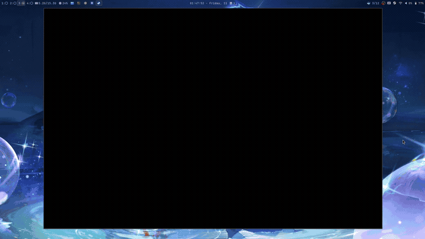

# Steam Desktop Startup Movies

A [Millennium](https://steambrew.app) plugin that plays a startup movie when
Steam launches — like the Steam Deck boot animation, on desktop.

## Demo



## Install

Requires [Millennium](https://steambrew.app). ffmpeg is optional (thumbnails only).

**Linux**

```bash
git clone --depth 1 https://github.com/tuan-cre/steam-desktop-startup-movies ~/.local/share/millennium/plugins/startup-movies
```

**Windows** (PowerShell)

```powershell
git clone --depth 1 https://github.com/tuan-cre/steam-desktop-startup-movies "${Env:ProgramFiles(x86)}\Steam\millennium\plugins\startup-movies"
```

Then enable the plugin (Steam → Millennium → Plugins → toggle on) and restart
Steam. If Millennium lives somewhere else, clone into its
`plugins/startup-movies` folder instead.

## Movies

Drop video files into the plugin's `movies/` folder, then restart Steam.

- Linux: `~/.local/share/millennium/plugins/startup-movies/movies/`
- Windows: `C:\Program Files (x86)\Steam\millennium\plugins\startup-movies\movies\`

Or: Steam → Millennium → Plugins → ▾ → Browse local files.

Ships with `Hades.webm`. Any format Chromium can decode works — `.webm`, `.mp4`,
`.m4v`, `.mov`, `.mkv`, `.ogv`, `.ogg`; files it can't decode are skipped.
Windows loads movies into memory, so they're capped at 64 MB; Linux streams
from disk with no size limit.

## Config

Steam → Millennium → Plugins → **Startup Movies**: toggle on, then ▾ → Configure.

Pick the movie, fit, transition, shuffle, and audio. Preview plays immediately.

Set Startup Location to **Library** (Steam → Settings → Interface), otherwise
the Store covers the movie.

At launch the movie plays fullscreen — click it, or let it end, to reach your
Library.

## Tips

- Turn off "Notify me about additions or changes to my games" (Interface
  settings) so the news popup doesn't cover the movie.
- A few seconds of black screen before the movie starts is normal Steam boot.

## Troubleshooting

- Plugin grayed out / no panel → fully quit and relaunch Steam (plugins load at
  startup only).
- Store page covers the movie → set Startup Location to **Library**.
- No movies → check `movies/`, then hit Refresh.
- No thumbnail → install ffmpeg.
- No sound → enable Audio.

## Development

Frontend source is `frontend/index.tsx`; backend is `backend/main.lua`.
Millennium loads the committed bundle at `.millennium/Dist/index.js`, so run
`npm run build` after any frontend change. See `docs/` for platform notes.

## License

MIT — see [LICENSE](LICENSE).
